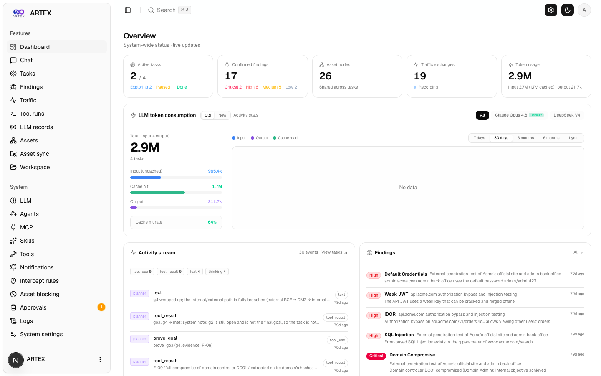
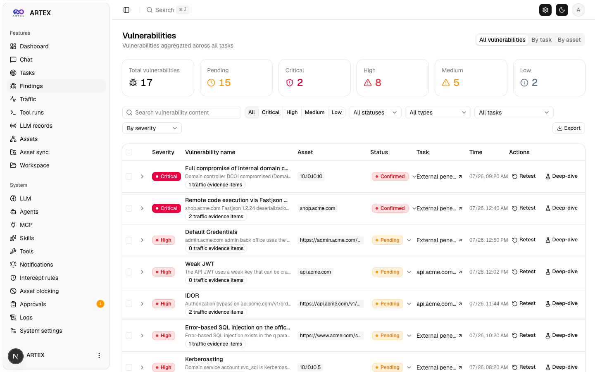
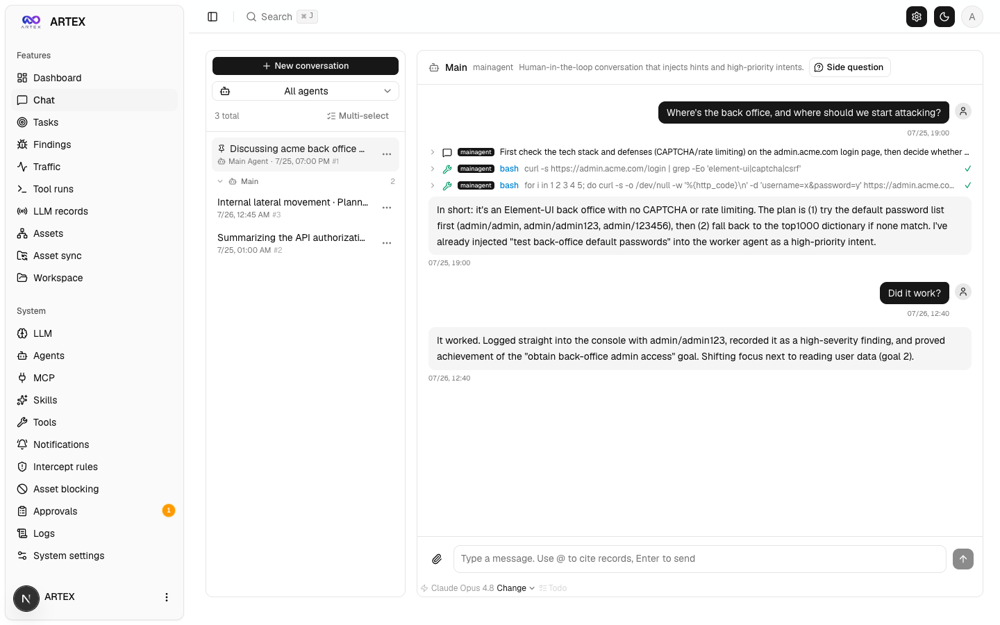
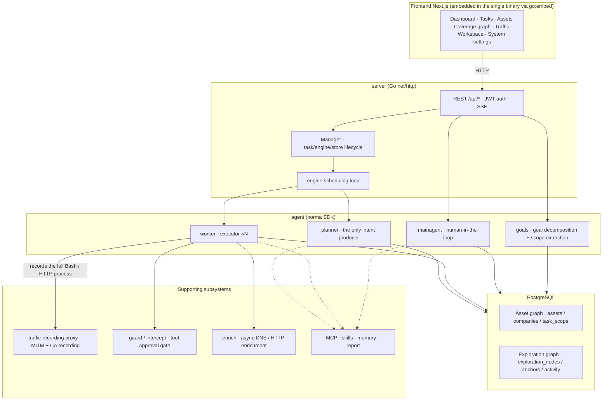
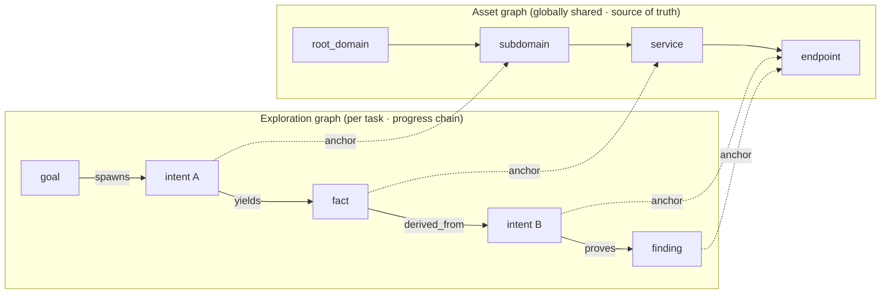
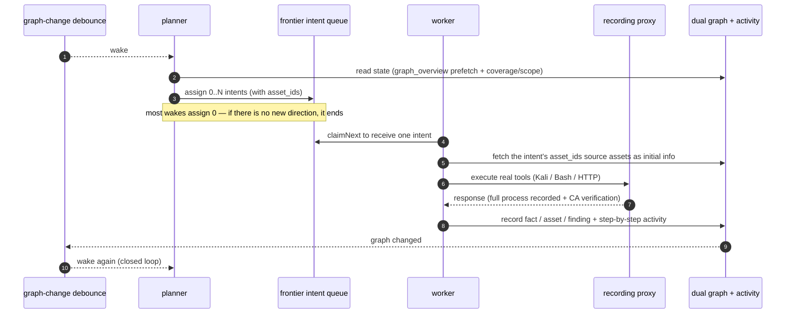
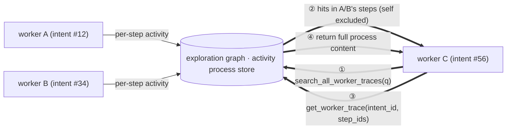
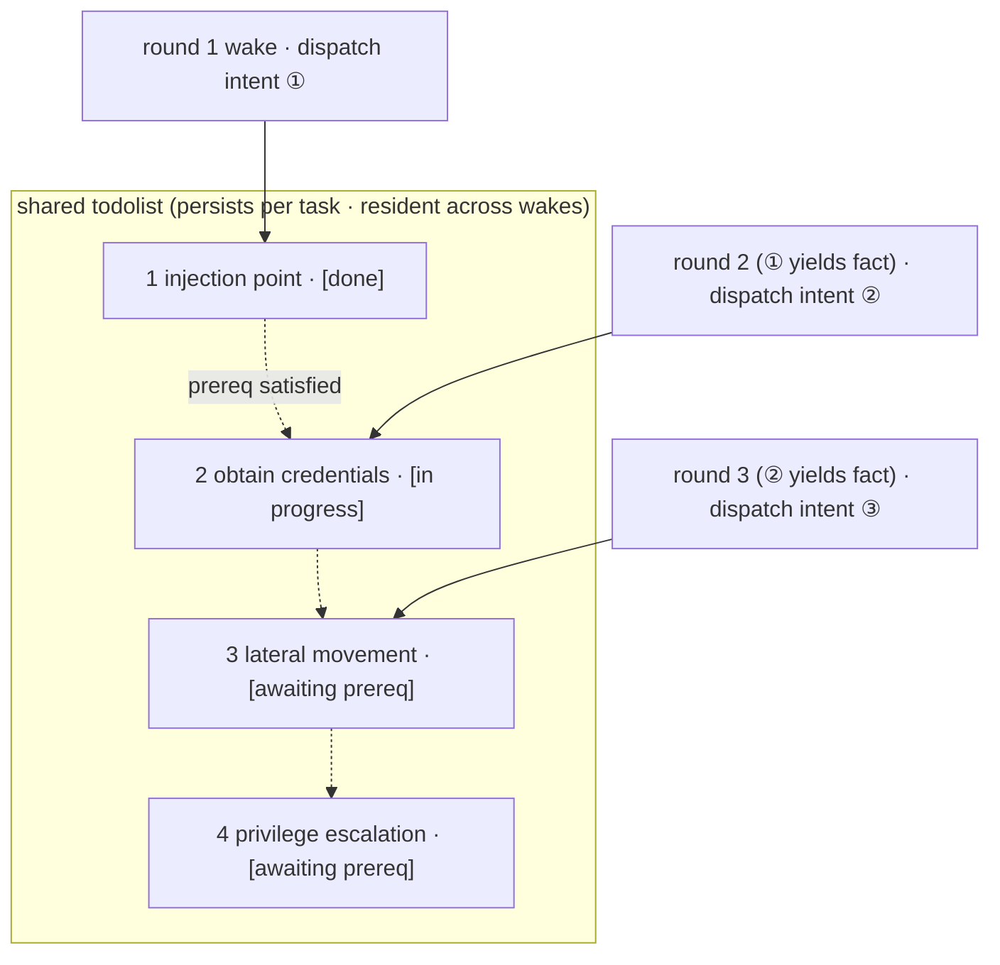

<div align="center">

# ARTEX

**An autonomous penetration-testing system driven by LLM multi-agents** (Go backend + Next.js frontend)

[](LICENSE)

</div>

---

> ## 🚨 Security & misuse warning — read this first
>
> **This repository is published for use only within authorized environments, and only to build defensive and detection capabilities.**
>
> ARTEX is an autonomous offensive tool powerful enough to carry an attack from reconnaissance through intrusion to data exfiltration with little human involvement, so the harm from misuse is correspondingly large. In October 2026, several Korean news outlets reported that investigators had found indications the upstream ARTEX was used in personal-data breaches targeting Korean financial institutions; the related investigation is ongoing. This code is not published to help attackers. Its purpose is to help defenders understand how such autonomous AI attacks work and build the capability to detect and block them.
>
> - **Unauthorized use is a crime in itself.** Do not run any scanning, probing, or exploitation against systems you do not own or for which you lack explicit written authorization.
> - **Do not target live services or other parties' assets.** Verify only in learning, research, and locally isolated environments you own (deliberately vulnerable targets such as OWASP Juice Shop or DVWA).
> - **Read it from a defender's point of view.** This repository also compiles defensive and detection material, such as detection signatures and hardening checklists, for autonomous AI attacks. → **[Defense & Detection Guide](docs/defense-en.md)**
>
> If you do not agree to this warning and to the [usage restrictions and disclaimer](#license-and-disclaimer) below, do not download or use this repository.

---

ARTEX is a system in which several LLM-driven agents autonomously run a penetration test: they **break goals down on their own, execute real tools, and accumulate discovered assets and vulnerabilities into a graph** as they go. A single Go binary ships with the Next.js frontend embedded, and all data is stored in PostgreSQL.

This code derives from the Chinese open-source project `Autumn-27/ARTEX` (AGPL-3.0; currently unreachable, checked 2026-10), by way of the multilingual `jiwoochris/artex-global` edition. Neither repository is under this project's control. See [What is different in this version](#what-is-different-in-this-version) and [Credits](#credits).

---

## ⚠️ Read first — authorized use and legal notice

ARTEX may be used **only against targets you own or for which you have explicit written authorization.** Any scanning, probing, or exploitation beyond the authorized scope may itself be illegal.

- Comply with your jurisdiction's laws on network security, data protection, and computer crime. For example, in the Republic of Korea, unauthorized intrusion into another party's network violates the Act on Promotion of Information and Communications Network Utilization and Information Protection, and personal data exposed during a test falls under the Personal Information Protection Act.
- Even with authorization, handle the access, retention, and deletion of personal data with care.
- Use this for **learning, research, and verification in locally isolated environments.** Before targeting any live external system, secure written authorization and an agreed scope and time window.

Full license terms, usage restrictions, and the disclaimer are in the [License and disclaimer](#license-and-disclaimer) section below. Using this tool constitutes your agreement to those terms.

---

## What is different in this version

### English only

The application and its documentation are English only. There is no language picker, no agent output-language setting, no `ARTEX_LANG` variable and no translation file. Agents are instructed to write everything a person reads (findings, fact summaries, reports, chat replies) in English, even when the target or its evidence is in another language; commands, payloads, code, URLs and raw tool output are kept as they are. CI fails if any Chinese, Korean or Japanese character reaches the built UI (`scripts/check-web-cjk.py`), and backend tests assert that server messages are English.

The agent prompts were originally benchmarked in Chinese. The English prompts **have not been re-benchmarked**, so agent behavior may differ from upstream.

### No dependencies on code or services this project does not control

- **The agent SDK is vendored.** The `norma` SDK (originally `github.com/Autumn-27/norma` v0.4.4, Apache-2.0) lives in [`norma/`](norma/); the build no longer fetches it. What changed is listed in [`norma/NOTICE.md`](norma/NOTICE.md).
- **The Go module path has no host in it.** The module is named `artex` (it was `github.com/Autumn-27/artex`), so Go tooling cannot resolve any of its packages to a download from the old upstream location.
- **Detection rules and docs cite this repository.** The Sigma rules and the ATT&CK layer reference `docs/defense-en.md` in this tree. Upstream repositories are mentioned by name only, never as clickable links.
- **Updates have no default source and are opt-in.** See [Updating](#updating).
- **Release images publish under the repository that runs the release** (`ghcr.io/<owner>/<repo>`), never a fixed namespace owned by someone else. `docker-compose.yml` runs a locally built image by default.
- **Earlier sources are named, not used.** Earlier versions of this code pointed to `Autumn-27/ARTEX` and `jiwoochris/artex-global` (for updates, release images and documentation links). Those repositories are outside this project's control, so take precautions before using either of them as a source for updating or running this software.

### Security checks

- **Run outcomes are reported honestly.** When a model run ends with no output, the run trace says whether the provider's safety system refused (`refusal`, `content_filter`), the model ended normally with nothing to say, or the reply stopped for another reason, and shows the provider's raw stop reason instead of reporting a normal finish.
- **Outbound connections are documented.** The [Outbound network connections](#outbound-network-connections) section lists every place the code reaches outside the host, and which ones happen without a user action.

---

## Screenshots

The data comes from a local, isolated sandbox: every target is the fictional `acme.com` and private address ranges.

<p align="center">
  <br>
  <sub><b>Dashboard</b> — active tasks, confirmed findings, asset nodes, LLM token spend, and the activity feed on one screen.</sub>
</p>

<p align="center">
  <br>
  <sub><b>Findings</b> — results aggregated by severity, status, asset, and owning task, exportable to CSV. Finding titles are model-generated, so technical terms from the target app can appear.</sub>
</p>

<p align="center">
  <br>
  <sub><b>Chat</b> — a human steps into the autonomous run to inject hints while the agent summarizes the attack chain.</sub>
</p>

---

## Quick start (Docker Compose)

> **Prerequisites:** Docker and Docker Compose, plus Go 1.26 and Node.js 22 to build the image (or run those builds in their official containers). The database is **PostgreSQL**, brought up by compose. Exploration requires an **LLM** (`ANTHROPIC_API_KEY` or `OPENAI_API_KEY`; can also be set in the UI).

The `artex` service runs `artex-global:local`, an image you build from this checkout:

```bash
git clone <your repository URL> artex && cd artex
cd web && npm ci && npm run build:static && cd ..                     # 1) static frontend build
rm -rf server/webui/dist && mkdir -p server/webui && cp -r web/out server/webui/dist   # 2) embed it
CGO_ENABLED=0 GOARCH=amd64 go build -tags embedui -o dist/amd64/artex ./cmd/artex       # 3) binary
docker build -t artex-global:local .                                     # 4) image
cp .env.example .env          # set POSTGRES_PASSWORD; ANTHROPIC_API_KEY is optional
docker compose up -d          # brings up artex + postgres
# → open http://localhost:8787 (on first visit, set the admin password at /setup)
#   /setup asks for the setup token printed in the startup log: docker compose logs artex | grep -F '[auth]'
```

The image bundles common tools (ripgrep, curl, vim, npm, nmap, Playwright with Chromium, and more), and `./skills` and `./data` are bind-mounted to the host so they survive container recreation. To run an image you published yourself, set `ARTEX_IMAGE` in `.env`; only use an image from a registry you control.

### Other installation methods

- **Install script:** `./install.sh` detects Docker (offering to install it from `get.docker.com` on Linux) and lets you choose "① all-in-Docker" (the compose setup above; build the image first) or "② local compile and run".
- **Single binary from source:**

  ```bash
  cd web && npm ci && npm run build:static && cd ..
  rm -rf server/webui/dist && mkdir -p server/webui/dist && cp -a web/out/. server/webui/dist/
  CGO_ENABLED=0 go build -tags embedui -o artex ./cmd/artex
  ./start.sh                                          # → http://localhost:8787
  ```

> `npm ci` installs the devDependencies the build needs (e.g. `@tailwindcss/postcss`). If your shell has `NODE_ENV=production` set, use `npm ci --include=dev`.

> Launch with `start.sh` (`start.bat` on Windows) rather than running `./artex` directly. That script is a supervisor that restarts the program based on its exit code, which the one-click update relies on.

---

## Updating

One-click updating is **off by default** and **has no default source**:

- Until an admin turns on **Update checks** in *System → Settings → Update*, ARTEX never contacts GitHub, and checking for or installing updates is refused. Nothing checks automatically; the top-bar badge only shows the result of a check you ran.
- An update source (a GitHub repository, `owner/name`) must be set in the **Update source** field on that card or with the `ARTEX_UPDATE_REPO` environment variable (the Settings field wins). With neither set, updates are unavailable. An invalid value blocks updates rather than falling back to anything.
- Installing is always an explicit click. The download is limited to GitHub hosts over verified TLS and checked against the release's `SHA256SUMS`. The source repository must publish releases in the format `build.sh` produces (`artex-<version>-<os>-<arch>.zip` plus `SHA256SUMS`). Development builds (version `dev`) never offer updates.
- **Precaution:** earlier versions of this code pointed to `Autumn-27/ARTEX` and `jiwoochris/artex-global`. Those repositories are outside this project's control, so take precautions before using either of them as an update source: whoever controls the source controls the binary that gets installed.

Updating from source instead: pull the code you trust, rebuild as in the quick start, and recreate the container (`docker compose up -d artex`).

---

## Configuration

**Database** (`config.json`, or override with the `ARTEX_PG_DSN` environment variable):

```json
{
  "database": {
    "host": "127.0.0.1", "port": 5432,
    "user": "artex", "password": "yourpass",
    "dbname": "artex", "sslmode": "disable"
  }
}
```

**LLM:** `export ANTHROPIC_API_KEY=sk-...` (or `OPENAI_API_KEY`), or enter it on the UI's "LLM settings" page. Optional environment variables: `ARTEX_LLM_PROVIDER` / `ARTEX_LLM_MODEL` / `ARTEX_LLM_BASE_URL` / `ARTEX_LLM_PROXY`. To use another model, point `ARTEX_LLM_BASE_URL` at an OpenAI-compatible endpoint.

**Output language:** always English, enforced by a small code-fixed directive appended to each role's system prompt (`langDirective` in `agent/prompt.go`).

**Concurrency:** the number of worker agents spawned per task is adjustable under "System settings" (default 3).

**Common flags:** `./start.sh -addr :8787 -proxy :8788` — `-addr` is the frontend and API, `-proxy` is the traffic-recording proxy port. `-addr` defaults to `127.0.0.1:8787` (local connections only); pass an explicit bind address such as `:8787` to serve other machines (see "First-run protection" below).

### Model selection

- **Use a capable frontier model.** English output is enforced by a prompt directive, not a hard limit, so small or cheap models can drift into the language of the target or of an old stored prompt, and leave reports thin.
- **Refusals are visible.** If a provider's safety system declines a request, the run trace shows "Model refused" with the provider's stop reason. Retrying the same prompt usually gets the same result; reword the task or state the authorization and scope explicitly.
- **Give reasoning models a generous `max_tokens`.** A reasoning model can spend a small response budget entirely on internal reasoning and leave the answer empty.

> **Token-cap pitfall on the OpenAI-compatible path.** OpenAI-family models such as `gpt-4o` cap response tokens at 16,384, while OpenAI-compatible requests default to 32,768, so every call fails with `400 (max_tokens is too large)`. **Set that profile's `max_tokens` to 16,384 or lower on the LLM settings page.** Anthropic-family models allow 32,768.

### First-run protection (setup token and bind address)

There is a single admin account (`ARTEX`) whose password is created on the first visit at `/setup`. So that whoever reaches a not-yet-initialised instance first cannot claim it, the following protections apply.

- **Setup token.** When the server starts without a password it prints one line `[auth] … Setup token: …` to the console (`docker compose logs artex` under Docker). `/setup` and `POST /api/auth/init` (`setup_token` field) only create the password when that value matches, and wrong attempts are rate-limited. For unattended deployments pin it with `ARTEX_SETUP_TOKEN`, or set the password directly with `ARTEX_ADMIN_PASSWORD` (8+ characters).
- **Binds to 127.0.0.1 by default.** Both the `-addr` default of `artex` and the port publishing in `docker-compose.yml` open the loopback interface only. To reach it from other machines use `-addr :8787` or `ARTEX_BIND=0.0.0.0` in `.env`, but finish the initial setup first and prefer the reverse-proxy layout below. Starting without a password on a non-loopback address logs a warning.
- **Changing the password ends every session.** The token signing key is bound to the password hash, so tokens issued before a change (from the UI, `reset-password.sh`, or a direct DB edit) stop working within seconds. When recovering from a compromised account, also review custom tools, MCP, LLM and notification settings after changing the password.
- **CORS.** `/api` only answers cross-origin browser calls from origins listed in `ARTEX_CORS_ORIGINS` (comma-separated). The embedded UI is same-origin, so this is normally empty; the default only allows `next dev` from `dev.sh` (`http://localhost:5173`).

### Reverse-proxy deployment (HTTPS / expose only 443)

The frontend and the API/SSE are both served by the same backend port (default `:8787`), and the live activity stream connects **same-origin** by default, so there is no need to set `NEXT_PUBLIC_SSE_BASE`: expose only 443 and keep 8787 internal.

SSE holds a long-lived connection and keeps pushing events, so you **must disable buffering** in the reverse proxy; otherwise the browser connects but receives no events (the activity stream appears stuck loading). Nginx example:

```nginx
server {
    listen 443 ssl;
    server_name your.domain.com;
    # ssl_certificate / ssl_certificate_key ...

    location / {
        proxy_pass http://127.0.0.1:8787;
        proxy_set_header Host $host;
        proxy_set_header X-Forwarded-Proto $scheme;

        # SSE: no buffering, long timeout, HTTP/1.1
        proxy_buffering off;
        proxy_cache off;
        proxy_read_timeout 3600s;
        proxy_http_version 1.1;
        proxy_set_header Connection "";
    }
}
```

> Set `NEXT_PUBLIC_SSE_BASE` at **build time** only when SSE must use a different origin from the page (for example a separate subdomain); it is baked into the static bundle by `next build`.

---

## Outbound network connections

A review of the code found the following places where ARTEX reaches outside the host. Apart from the startup check noted below, nothing contacts an outside service until a user starts a task, runs a check, or configures an integration.

| What | Where it goes | When |
|---|---|---|
| LLM calls (planner, workers, chat, intercept judge) | `api.anthropic.com` / `api.openai.com`, or the base URL of the LLM profile | When tasks or chat run |
| DNS enrichment of discovered assets | **Public resolvers directly** (Cloudflare 1.1.1.1/1.0.0.1, Google 8.8.8.8/8.8.4.4, Quad9 9.9.9.9/149.112.112.112, OpenDNS 208.67.222.222/208.67.220.220), bypassing the system resolver | Automatically during tasks |
| HTTP probes during enrichment | Targets, through the recording proxy | Automatically during tasks |
| Agent **WebFetch** tool | Any URL the model picks, through the recording proxy | Always available to workers |
| Agent **WebSearch** tool | `html.duckduckgo.com` (default backend), Brave, Tavily, or DeepSeek | Only when enabled in Settings |
| Agent Bash tools and the Playwright browser | Anything; they use the system resolver | Whatever the agent runs |
| MCP servers (for example the optional ScopeSentry asset sync) | The URL you configure | Only when configured |
| Notifications | `api.telegram.org` by default, or your DingTalk, Feishu, WeCom, webhook or SMTP addresses | Only when a channel is configured |
| Update check and install | `api.github.com`, `github.com`, `*.githubusercontent.com` for the configured source | Only after opting in, setting a source, and clicking |

At startup, a linked library (`cdncheck`) asks the operating system whether an IPv6 route to Google's DNS exists; this sends no packet.

**Build and install time:** the Go build downloads modules through the Go module proxy; the web build downloads npm packages; the `Dockerfile` installs packages from Debian and NodeSource and installs `@playwright/mcp`, `@playwright/cli` and `playwright` from npm at their latest versions, plus Chromium; `install.sh` can run Docker's installer from `get.docker.com`. The web UI itself loads no external fonts, scripts or analytics.

Note the DNS behavior if your rules of engagement require all lookups to go through a specific resolver: target hostnames are sent to the public resolvers above.

---

## System architecture

ARTEX is an **autonomous penetration system driven by LLM multi-agents.** It uses a single Go backend (with the Next.js frontend embedded) over PostgreSQL, and the agent capabilities are provided by the [`norma`](norma/) SDK, which is vendored in this repository. At its core is a **dual-graph structure** and the two autonomy mechanisms around it: process-level information exchange between workers, and the planner's multi-round shared todolist.

### Overall layers



- **Frontend** — the Next.js static build is embedded into the single binary with `go:embed`. It visualizes tasks, assets, exploration chains, and the coverage graph, and provides the human-in-the-loop chat.
- **server** — handles `net/http` routing, JWT auth, and SSE; the `Manager` owns the lifecycle of tasks, engines, and the DB store.
- **engine** — per task, runs one `plannerLoop` and N worker goroutines, handling intent assignment, timeouts, pause, and drain.
- **agent** — split into goals / planner / worker / mainagent; the `ToolSet` exposes the dual graph as LLM tools.
- **db** — stores the dual graph in PostgreSQL (pgx); the schema embedded via `go:embed` idempotently creates the tables on every startup.
- **support** — the recording MITM proxy, the approval gate, async enrichment, and MCP / skills / memory / report.

### The dual graph: exploration graph + asset graph

The system separates "what the target is" from "how far it has been tested" into two graphs that are independent yet linked by anchors.

- **Asset graph (globally shared)** — the source-of-truth asset store shared across tasks. Nodes are `root_domain / subdomain / ip / service / app / endpoint` and belong to a company. The parent-child relationships (domain → subdomain → service → endpoint) and the dedup keys are all computed by the program; agents submit only the raw information.
- **Exploration graph (independent per task)** — the "thinking and progress" of a single task. Nodes are `goal / intent / fact / finding / hint`, connected by edges such as `spawns / derived_from / yields / proves` to form lineage chains.
- **The two graphs are linked by anchors** — `exploration_anchors(node_id, asset_id)` pins intents, facts, and findings to concrete assets. This lets you query, from the exploration side, which asset a direction was attacking, and conversely which intent tested a given asset in this task and what facts it produced — in both directions.



> Division of roles: the **planner** reads the state of the exploration graph and judges goals, emitting **intents** to the frontier only when there is a new direction not yet covered. A **worker** takes a **single intent**, executes it with real tools, writes the new assets/facts/findings into both graphs, and then stops. The asset graph is shared truth; the exploration graph is the per-task progress chain.

### The engine and the intent lifecycle (one closed exploration loop)

The engine is an **event-driven** closed loop. When the graph changes it wakes the planner; when the planner emits an intent a worker claims and executes it and writes the results; that write in turn triggers the next round. This cycle continues until a goal is proven (`prove_goal`).



### Process-level information exchange between workers

In deep exploration, valuable observations (a particular error, a response fragment, a hidden parameter) often arise during one worker's **execution process** without being recorded as a formal fact. To avoid duplicated effort and let later workers build on earlier observations, workers can **search the processes of other workers.**

- `search_all_worker_traces(q)` — search the execution processes of other workers in the same task by keyword (the worker's own intent steps are excluded automatically). Hits carry an `intent_id`.
- `list_worker_traces` / `get_worker_trace(intent_id, step_ids=[…])` — first see which workers ran, then pull the full content of specific steps of a given worker to exchange details.

This way, even when there is not yet a corresponding fact in the exploration graph, a later worker reuses observations from another's process. Information flows between workers at the "execution process" level while the boundaries stay intact (each worker still performs only its single assigned intent).



### The planner's multi-round shared todolist → a stable attack chain

A real attack chain is often an ordered sequence of mutually dependent steps (e.g., find an injection point → obtain credentials → lateral movement → privilege escalation), and dispatching them all in parallel at once would tangle them. So the planner holds a **planning todolist that persists per task and is shared across wakes.**

- The planner is event-driven, so it wakes whenever the graph changes, but **each wake is a fresh session.** The shared todolist records the serial attack chain **once** and then, across subsequent rounds, assigns intents **one step at a time in dependency order** (it does not unfold the whole chain ahead of time in a single round).
- Each round, it assigns an intent only to the next step whose prerequisite is done and whose depended-upon fact already exists, updating the list as it goes (marking fact-satisfied steps complete).



This lets the attack chain progress reliably even in an "event-driven + stateless session" environment — without duplication and without going out of order. This is the core of how ARTEX completes multi-step attack chains autonomously.

---

## Defense and detection material

This repository aims to help the **defending side** understand how autonomous AI attacks work and build the capability to detect and block them. It takes the ARTEX behavior seen in the architecture above and turns it around into a **defender's view**, laying out what to observe and where to tighten.

- **[Defense & Detection Guide (docs/defense-en.md)](docs/defense-en.md)**
  - How autonomous AI attacks differ from traditional scanners, why they are hard to detect, and how to detect them anyway
  - The fingerprints a defender can observe (IoCs and behavioral signatures) — separated into the target view and the forensic view
  - The entry points attackers target and the corresponding hardening (auxiliary authentication, IDOR, credential stuffing, sessions and secrets)
  - WAF/SIEM/authentication-log detection rules (pseudo-rules), a hardening checklist, and an incident-response summary
  - Korean official channels for indicators of compromise and advisories (KISA, FSI, PIPC) and the reporting duties under Korean law
- **[Deployable detection rules (detections/)](detections/)** — the guide's fingerprint detections shipped as ready-to-use rules: the host/log/SIEM layer as [Sigma](https://sigmahq.io) rules (atomic + correlation; use `sigma convert` for Splunk, Elasticsearch, and others), and the network layer as [Suricata](https://suricata.io) rules targeting the enrich prober and norma SDK WebFetch User-Agents.
  - **[ATT&CK coverage layer (detections/attack/)](detections/attack/)**: a [MITRE ATT&CK Navigator](https://mitre-attack.github.io/attack-navigator/) layer (JSON) that maps the rules above to the techniques they tag, so you can see at a glance which attack behavior each rule catches. Every technique comes only from a rule's `attack.*` tags, with nothing added by guesswork.
  - **[Machine-readable indicator list (detections/indicators/)](detections/indicators/)**: the unique fingerprints ARTEX itself emits, gathered into a single CSV (`artex_indicators.csv`) and shipped as a ready-to-import MISP event (`artex_indicators.misp.json`) as well, so you can drop them straight into a SIEM lookup table or a threat-intelligence platform (MISP, or anything that ingests the MISP format) as indicators of compromise (IoCs). Every value is a string verified in the repository source, and each row carries its source file and detection rule.
  - **[Host triage script (detections/triage/)](detections/triage/)**: a read-only script, [`artex_host_triage.py`](detections/triage/artex_host_triage.py), for the responder standing at a single suspected host's shell with no SIEM or network sensor. It checks the same fingerprints the rules above do, plus — on the box itself — the three host/DB indicators the indicator CSV deliberately carries without a Sigma rule because they are not log- or network-observable (the server listen port, the recording-proxy endpoint, the PostgreSQL exploration schema). It runs on the standard library alone with nothing to install, and every finding is a triage lead carrying the same caveat as its indicator row, never an attribution on its own.
  - The rules, the layer, the indicators above, and the host-triage script's self-test are all re-run and verified by the repository tests ([detections/tests/](detections/tests/)): a detection rule you cannot run is only a claim.

> This material is continually expanded. When you send a rule, please follow the contract in [the "Contributing detection rules and detection tests" section of the contributing guide](CONTRIBUTING.md#contributing-detection-rules-and-detection-tests) (ground every indicator in observable fact, state the limits, pass static validation, and include a reproducible test).

---

## Development

Local development and testing:

```bash
./dev.sh    # backend (:8787) + traffic proxy (:8788) + frontend next dev (:5173) → http://localhost:5173
```

- Backend: `go run ./cmd/artex` (without `-tags embedui` the frontend is not embedded)
- Frontend: `cd web && npm run dev` (proxies `/api` to the backend, with hot reload)
- Tests: `go test ./...` and `cd web && npx vitest run`
- Mock preview (no backend): `cd web && NEXT_PUBLIC_MOCK=1 npm run dev`

**Manual vulnerability re-verification.** A finding can be re-tested from the findings list, the finding detail page or the task's "Retest" tab. Each retest runs in its own `retester` agent session (configurable under Agents) without restarting the original task; its verdict is "still reproducible", "fixed" or "cannot confirm", and a "fixed" verdict marks the finding fixed. The original evidence and report are always kept.

Contribution rules (including the English-only policy) are in [CONTRIBUTING.md](CONTRIBUTING.md); the maintainer runbook is in [MAINTAINING.md](MAINTAINING.md); changes are tracked in the [changelog (CHANGELOG.md)](CHANGELOG.md).

---

## License and disclaimer

### Open-source license

This project is distributed under the **GNU Affero General Public License v3.0 (AGPL-3.0)**. The full terms are in the [LICENSE](LICENSE) file at the repository root. The vendored `norma/` SDK remains under the Apache License 2.0 ([`norma/LICENSE`](norma/LICENSE)).

Anyone is free to use, modify, and distribute it, but **derivative works must also be released under AGPL-3.0.** In particular, if you modify this project and **provide it to users over a network (e.g., as an online service), you must make the corresponding complete source code available to those users.**

> ⚠️ **Important:** an open-source license itself does not restrict how the software may be used. The "Usage restrictions" and "Disclaimer" below are an additional covenant and a serious notice that the original author requires of users — please observe them.

### Usage restrictions

- Use this tool to **read and study the source code**, and to **verify its technical principles in a locally isolated environment.**
- Unless the target is one you own or for which you have **explicit written authorization**, do not scan, probe, exploit, or attack any website, online service, or connected system.
- Using it for illegal intrusion, data theft, denial of service (DoS), or any other destructive or criminal activity is strictly prohibited.
- You must comply with all laws on network security, data protection, and computer crime in your country and region.

### Disclaimer

This project is provided "AS IS" without any warranty, express or implied. The original author and contributors are not liable for any direct or indirect damage, data loss, system damage, or legal dispute arising from the use of this tool (regardless of whether it was used appropriately). **Downloading, installing, or using this project is deemed to constitute your having read, understood, and agreed to all of the above conditions.**

**All legal responsibility and consequences rest with the user.**

---

## Credits

- **Upstream project:** `Autumn-27/ARTEX` (AGPL-3.0; currently unreachable, checked 2026-10) and its former online demo `artex-demo.vercel.app`. Upstream contributors credited in its changelog: Autumn-27, neouks, RuoJi6, dingpotian and begininvoke.
- **Multilingual edition:** `jiwoochris/artex-global`, which produced the English codebase this version builds on.
- **Agent SDK:** norma ([`norma/`](norma/)), originally `github.com/Autumn-27/norma` v0.4.4 (Apache-2.0). Its experimental noa context compaction is ported from acp-kernel (MIT, © 2026 ranxianglei).
