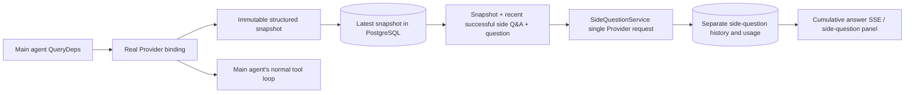

# ARTEX `/btw` Side Questions

English · [中文](README.zh.md)

Regular chats, a task's MainAgent, and Workers launched directly by the current task each support side questions that are kept separate from the main conversation. Typing `/btw question` in the main input box submits a side question; typing `/btw` alone or clicking the "Side question" button opens earlier side-question history. On desktop it appears as a resizable sidebar; on mobile, as a drawer.

A side-question answer is generated from a snapshot of the agent's context taken when the question was submitted, and supports streaming display, follow-up questions, stopping and clearing. Closing the panel, reloading the page or losing the SSE connection does not cancel the model request. Stop affects only the one side question in progress; Clear cancels side questions and deletes the side-question history, but leaves the main-context snapshot in place.

> This document is an English translation of the original Chinese document (`README.zh.md`). The original is kept unchanged so upstream changes are easy to compare.

## Scope

It uses Go, norma v0.3.7, Next.js, and the existing Markdown, ResizablePanel, Drawer and AlertDialog components as they are; norma's source is not modified and no new dependencies were added for side questions. The Planner, Workers inherited from other tasks, and promotion of tool-style subtasks are out of scope.

- `capture.go` marks requests as main-loop requests only from `Options.Deps.CallModel` and `CallModelSync`. The Provider decorator sits inside each individual model — after the routing pool has picked a model on the outside — so it records the model actually selected. Compaction and summary requests do not overwrite the snapshot.
- Snapshots are published when a request starts, when the model completes a response, and when the run reaches a terminal state. Half-finished responses still being generated are not published. Tool calls stay paired via norma's `MessagesForAPI`, and tool results enter the snapshot at the next main-model request or at the run's terminal state. If streaming is interrupted, the previous valid boundary is kept.
- Snapshots use a JSON deep copy to preserve structured messages, the system prompt, tool definitions and generation parameters. Model inference never holds a snapshot lock or a database transaction.
- `SideQuestionService` calls an individual Provider. When needed it first builds a side-question summary, and the final answer is retried once with reduced context only when the context first exceeds the limit and no text or tool call has been emitted yet. It does not create a new agent session, is not connected to the tool executor, main transcript, activity stream or task graph, and does not go through the task's model failover chain. The answer request keeps the tool definitions only for compatibility with the existing structured tool context; summary requests are given no tools. Newly returned tool calls have no execution path.
- There is one running request per parent session, at most four per service process, and a 120-second timeout per request. Side questions use an independent cancellation context under the service lifecycle.
- A side-question request stores a model-config reference and a summary of non-sensitive identifying information, and fetches credentials from the existing config at request time. If the config is deleted or an identifying field such as model, protocol or address changes, the user is asked to run the main agent first to refresh the snapshot. Tests do not change the product's default model.

## Persistence and recovery

`db/schema.sql` creates the `side_question_sessions` and `side_question_requests` tables automatically. The former stores the parent resource, latest snapshot, run number, version and clear version; the latter stores the question, cumulative answer, status, model, snapshot time, usage, event sequence and page ordinal.

The parent session key is either the conversation ID or the combination of task ID, exploration ID and intent ID. Workers do not use reusable execution-slot names.

Snapshots are merged per parent session and flushed once every 250 milliseconds; the database compares `(run_id, version)` so an older version can never overwrite a newer one. The selected snapshot is saved once more right before a side question is submitted. On success the large in-memory snapshot is released; on failure the not-yet-written version is kept. Cumulative answer content is written at most once every 250 milliseconds as streaming events arrive, and saved immediately on a terminal state, retrying a bounded number of times on database errors.

On service startup, requests left in `running` state are marked `interrupted`; partial answers and usage already stored in the database are kept, and requests are not re-run automatically. The most recently saved context is immediately usable for the next question. If an old session has no snapshot, the user is asked to run the main agent first; context is never reconstructed from the UI activity log.

Clear bumps the clear version and deletes the requests, and conditional updates prevent late-arriving callbacks from writing again. Physical deletion of a parent resource relies on foreign-key cascades; logical deletion of a Worker deletes its side-question data in the same transaction and then rejects any late-arriving snapshot. Archiving a task first blocks new requests, waits for the main flow to stop, cancels side questions and waits for that to reach the database. The archive format is v3 and remains compatible with v1 and v2, which have no side-question tables.

History is stored in full and returned at most 20 items per page using an ordinal cursor. Model requests re-send the raw text of up to 20 of the most recent successful exchanges, limited to fit the token budget, and older exchanges are kept in a separate rolling summary. When the main context exceeds the budget, only the older part of the side-question copy is summarized; recent structured tool calls and their results are kept. Summaries, preparation progress and usage all fall under the side question's concurrency, cancellation and 120-second timeout rules. See [Context budget and open-source references (CONTEXT_BUDGET.md)](CONTEXT_BUDGET.md) for details.

## HTTP contract

The following paths are used as `{parent}` and follow the existing authentication and resource checks.

- `/api/conversations/{id}`
- `/api/tasks/{id}/chat`
- `/api/tasks/{id}/intents/{iid}`

Responses and behavior per request:

- `GET {parent}/side-questions?before={ordinal}` returns `items` sorted newest first, along with the running state (`current`), snapshot metadata (`snapshot`) and the next cursor (`next_cursor`). A cursor of 0 means the newest page or no further pages.
- `POST {parent}/side-questions` takes JSON of the form `{ "question": "…", "client_request_id": "UUID" }`. A new request returns 202 with the request object; the same ID and question return the existing object with 200.
- `DELETE {parent}/side-questions` cancels and clears the side-question exchanges of the current parent session.
- `GET /api/side-questions/{requestID}/events` sends `snapshot` SSE events, where `id` is an increasing sequence number and `data` is the full cumulative request object. A clear sends `cleared`.
- `POST /api/side-questions/{requestID}/cancel` cancels a request explicitly; the terminal state can be read from the history or the SSE stream.

Questions are limited to 4000 characters. A missing snapshot, a changed model config, a busy parent session or an idempotency-ID conflict returns 409; hitting the global concurrency cap returns 429. Every SSE connection sends the cumulative state first, so the client never depends on previously received text fragments. The frontend merges answers by request ID and sequence number, and discards stale callbacks when the parent session changes or is cleared.

## Validation and references

Automated checks, real-model usage and known limitations are documented in [VALIDATION.md](VALIDATION.md).

The independent-request approach follows [Grok CLI's side-question.ts (pinned commit)](https://github.com/superagent-ai/grok-cli/blob/fb97af83f06dca873281d60168430f06c8de6324/src/utils/side-question.ts), and execution isolation follows [OpenCode (pinned commit)](https://github.com/anomalyco/opencode/tree/b3f1a96c6dd7adeb28b36dd11add1998fc84d67b). ARTEX uses norma's structured messages for context rather than stitching text together from frontend logs.
